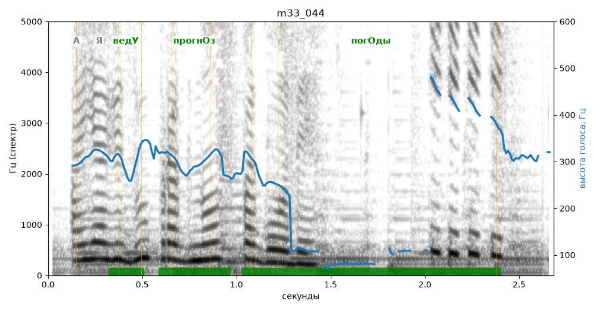

# m33_044

Голос: **Серия 33, Рон (302.9 с), голос iPhone** · длительность 2.7 с
Естественность (UTMOS): **1.31 из 5** (живой диктор ≈ 4–4.5)
Эталон: А я веду прогноз погоды!
Распознано: А я веду прогноз погоды.
Слова: все совпали

## Ударения
(где нужно: ruaccent)

| слово | нужно | у голоса | |
|---|---|---|---|
| веду | ведУ | ведУ | ✓ |
| прогноз | прогнОз | прогнОз | ✓ |
| погоды | погОды | погОды | ✓ |

## Интонация
- ✗ «а я веду прогноз погоды!» — восклицание звучит ровно, без эмоции
- Диапазон голоса 28.9 полутонов (живо), средняя высота 296 Гц

## Паузы и темп
- паузы на своих местах
- Темп 3.5 слога/с (медленно)

_Синяя линия — высота голоса. Над словами заглавная буква — где ударение должно быть; красным — голос поставил не туда (уверенно), оранжевым — возможно._
