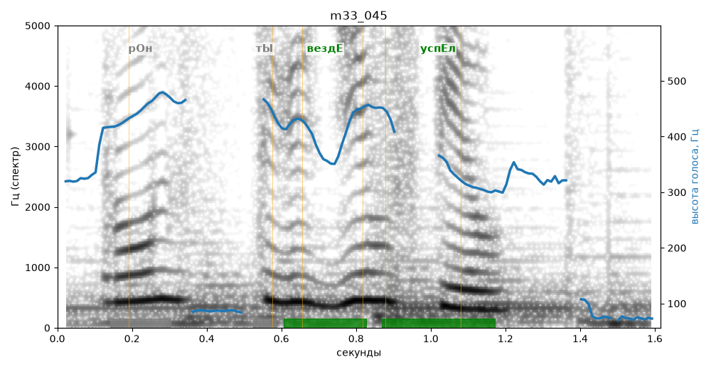

# m33_045

Голос: **Серия 33, Пик (305.6 с), голос iPhone** · длительность 1.6 с
Естественность (UTMOS): **1.33 из 5** (живой диктор ≈ 4–4.5)
Эталон: Рон, ты везде успел.
Распознано: Рун, ты ведь не успел?
Расхождения в словах: «рон» → «рун»; «везде» → «ведь не»

## Ударения
(где нужно: ruaccent)

| слово | нужно | у голоса | |
|---|---|---|---|
| везде | вездЕ | вездЕ | ✓ |
| успел | успЕл | успЕл | ✓ |

## Интонация
- ✓ «рон ты везде успел.» — конец фразы понижается — звучит законченно
- Диапазон голоса 31.9 полутонов (живо), средняя высота 336 Гц

## Паузы и темп
- паузы на своих местах
- Темп 7.4 слога/с (быстро)

_Синяя линия — высота голоса. Над словами заглавная буква — где ударение должно быть; красным — голос поставил не туда (уверенно), оранжевым — возможно._
