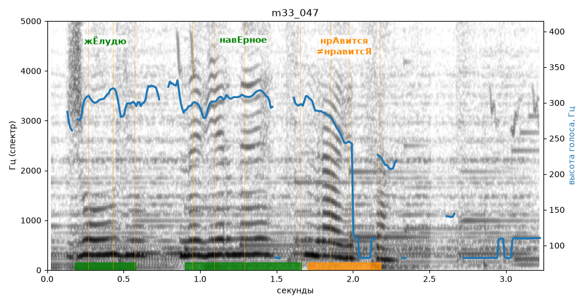

# m33_047

Голос: **Серия 33, Рон (321.0 с), голос iPhone** · длительность 3.2 с
Естественность (UTMOS): **1.27 из 5** (живой диктор ≈ 4–4.5)
Эталон: Жёлудю, наверное, нравится.
Распознано: Желудью, наверное, нравится.
Расхождения в словах: «желудю» → «желудью»

## Ударения
(где нужно: ruaccent)

| слово | нужно | у голоса | |
|---|---|---|---|
| жёлудю | жЁлудю | жЁлудю | ✓ |
| наверное | навЕрное | навЕрное | ✓ |
| нравится | нрАвится | нравитсЯ | ✗? возможно — послушать |

## Интонация
- ✓ «жёлудю наверное нравится.» — конец фразы понижается — звучит законченно
- Диапазон голоса 23.5 полутонов (живо), средняя высота 288 Гц

## Паузы и темп
- после «наверное,» нет паузы (0.04 с)
- Темп 5.9 слога/с (нормально)

_Синяя линия — высота голоса. Над словами заглавная буква — где ударение должно быть; красным — голос поставил не туда (уверенно), оранжевым — возможно._
