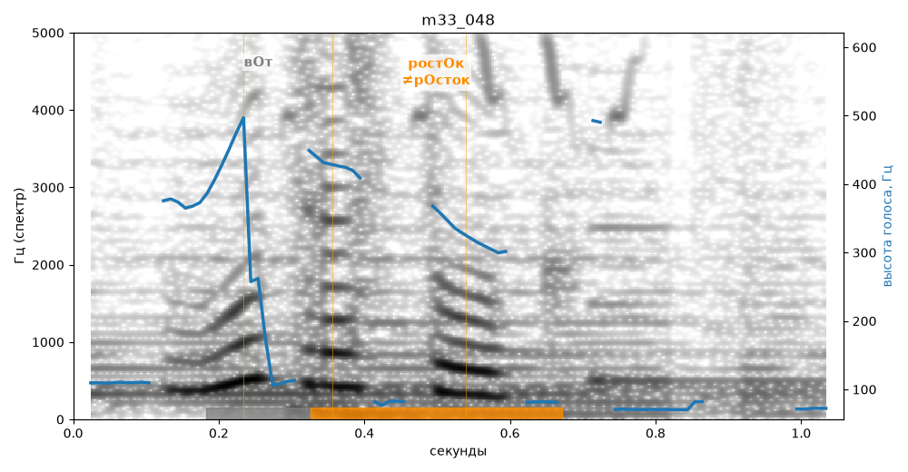

# m33_048

Голос: **Серия 33, Пик (327.3 с), голос iPhone** · длительность 1.1 с
Естественность (UTMOS): **1.29 из 5** (живой диктор ≈ 4–4.5)
Эталон: Вот росток!
Распознано: Утрасток!
Расхождения в словах: «вот росток» → «утрасток»

## Ударения
(где нужно: ruaccent)

| слово | нужно | у голоса | |
|---|---|---|---|
| росток | ростОк | рОсток | ✗? возможно — послушать |

## Интонация
- ✗ «вот росток!» — восклицание звучит ровно, без эмоции
- Диапазон голоса 32.3 полутонов (живо), средняя высота 111 Гц

## Паузы и темп
- паузы на своих местах
- Темп 6.1 слога/с (нормально)

_Синяя линия — высота голоса. Над словами заглавная буква — где ударение должно быть; красным — голос поставил не туда (уверенно), оранжевым — возможно._
