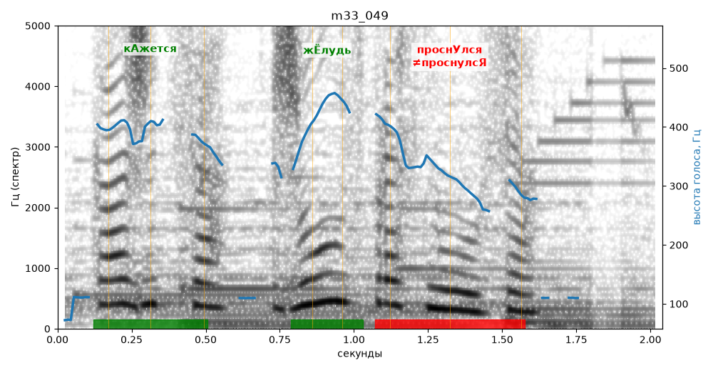

# m33_049

Голос: **Серия 33, Пик (328.3 с), голос iPhone** · длительность 2.0 с
Естественность (UTMOS): **1.34 из 5** (живой диктор ≈ 4–4.5)
Эталон: Кажется, жёлудь проснулся!
Распознано: Кажется, Жула спрошнулся.
Расхождения в словах: «желудь проснулся» → «жула спрошнулся»

## Ударения
(где нужно: ruaccent)

| слово | нужно | у голоса | |
|---|---|---|---|
| кажется | кАжется | кАжется | ✓ |
| жёлудь | жЁлудь | жЁлудь | ✓ |
| проснулся | проснУлся | проснулсЯ | ✗ ОШИБКА |

## Интонация
- ✗ «кажется жёлудь проснулся!» — восклицание звучит ровно, без эмоции
- Диапазон голоса 24.1 полутонов (живо), средняя высота 341 Гц

## Паузы и темп
- паузы на своих местах
- Темп 6.8 слога/с (быстро)

_Синяя линия — высота голоса. Над словами заглавная буква — где ударение должно быть; красным — голос поставил не туда (уверенно), оранжевым — возможно._
