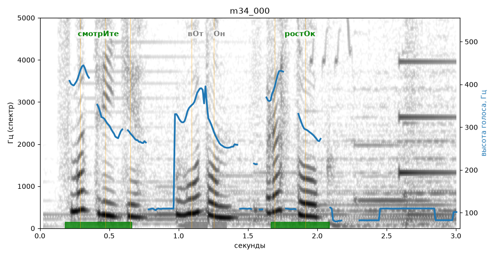

# m34_000

Голос: **Серия 34, Рон (0.2 с), голос iPhone** · длительность 3.0 с
Естественность (UTMOS): **1.67 из 5** (живой диктор ≈ 4–4.5)
Эталон: Смотрите! Вот он! Росток!
Распознано: Смотрите, вот он, расток!
Расхождения в словах: «росток» → «расток»

## Ударения
(где нужно: ruaccent)

| слово | нужно | у голоса | |
|---|---|---|---|
| смотрите | смотрИте | смотрИте | ✓ |
| росток | ростОк | ростОк | ✓ |

## Интонация
- ✗ «смотрите!» — восклицание звучит ровно, без эмоции
- Диапазон голоса 28.0 полутонов (живо), средняя высота 252 Гц

## Паузы и темп
- паузы на своих местах
- Темп 5.8 слога/с (нормально)

_Синяя линия — высота голоса. Над словами заглавная буква — где ударение должно быть; красным — голос поставил не туда (уверенно), оранжевым — возможно._
