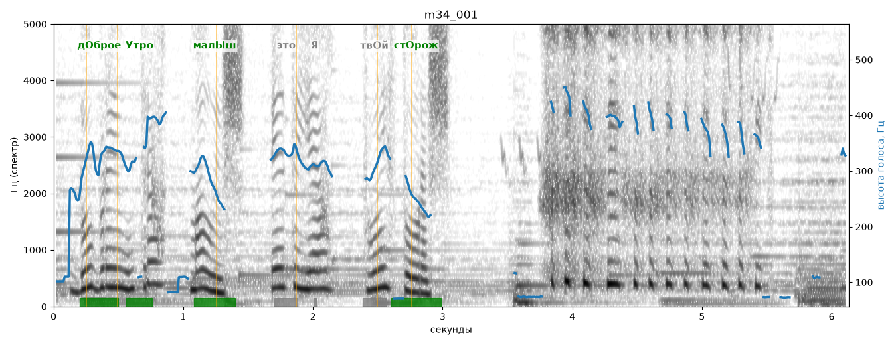

# m34_001

Голос: **Серия 34, Рон (3.2 с), голос iPhone** · длительность 6.1 с
Естественность (UTMOS): **1.29 из 5** (живой диктор ≈ 4–4.5)
Эталон: Доброе утро, малыш. Это я, твой сторож.
Распознано: Доброе утро, малыш! Это я, твоя история.
Расхождения в словах: «твой сторож» → «твоя история»

## Ударения
(где нужно: ruaccent)

| слово | нужно | у голоса | |
|---|---|---|---|
| доброе | дОброе | дОброе | ✓ |
| утро | Утро | Утро | ✓ |
| малыш | малЫш | малЫш | ✓ |
| это | это | Это | нет эталона |
| сторож | стОрож | стОрож | ✓ |

## Интонация
- ✓ «доброе утро малыш.» — конец фразы понижается — звучит законченно
- ✓ «это я твой сторож.» — конец фразы понижается — звучит законченно
- Диапазон голоса 29.5 полутонов (живо), средняя высота 315 Гц

## Паузы и темп
- паузы на своих местах
- Темп 6.7 слога/с (быстро)

_Синяя линия — высота голоса. Над словами заглавная буква — где ударение должно быть; красным — голос поставил не туда (уверенно), оранжевым — возможно._
