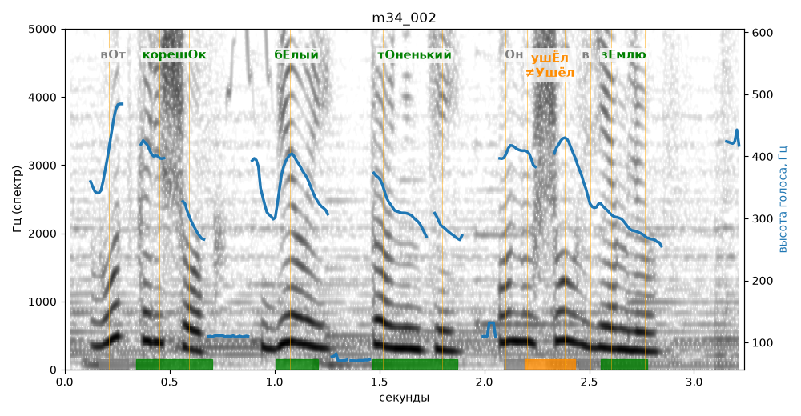

# m34_002

Голос: **Серия 34, Пик (14.5 с), голос iPhone** · длительность 3.2 с
Естественность (UTMOS): **1.47 из 5** (живой диктор ≈ 4–4.5)
Эталон: Вот корешок. Белый, тоненький. Он ушёл в землю.
Распознано: Вот крышок, белый, тоненький, он ушел в землю.
Расхождения в словах: «корешок» → «крышок»

## Ударения
(где нужно: ruaccent)

| слово | нужно | у голоса | |
|---|---|---|---|
| корешок | корешОк | корешОк | ✓ |
| белый | бЕлый | бЕлый | ✓ |
| тоненький | тОненький | тОненький | ✓ |
| ушёл | ушЁл | Ушёл | ✗? возможно — послушать |
| землю | зЕмлю | зЕмлю | ✓ |

## Интонация
- ✓ «вот корешок.» — конец фразы понижается — звучит законченно
- ✗ «белый тоненький.» — конец фразы не понижается — звучит незаконченно / как перечисление
- ✓ «он ушёл в землю.» — конец фразы понижается — звучит законченно
- Диапазон голоса 30.8 полутонов (живо), средняя высота 317 Гц

## Паузы и темп
- паузы на своих местах
- Темп 8.2 слога/с (быстро)

_Синяя линия — высота голоса. Над словами заглавная буква — где ударение должно быть; красным — голос поставил не туда (уверенно), оранжевым — возможно._
