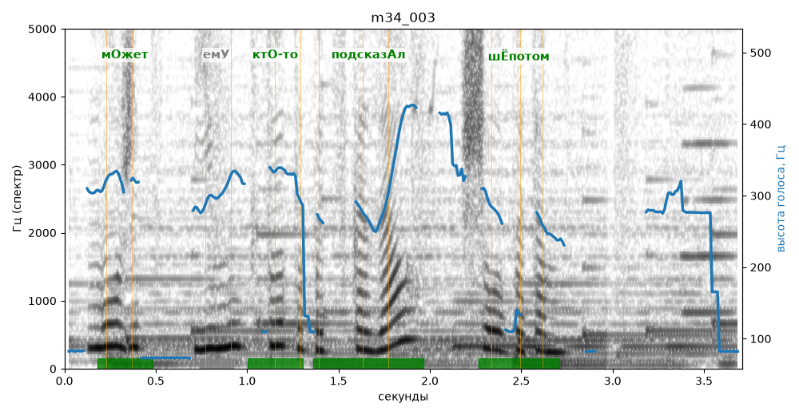

# m34_003

Голос: **Серия 34, Рон (24.3 с), голос iPhone** · длительность 3.7 с
Естественность (UTMOS): **1.26 из 5** (живой диктор ≈ 4–4.5)
Эталон: Может, ему кто-то подсказал? Шёпотом.
Распознано: Может, ему кто-то подсказал шепотом?
Слова: все совпали

## Ударения
(где нужно: ruaccent)

| слово | нужно | у голоса | |
|---|---|---|---|
| может | мОжет | мОжет | ✓ |
| ему | емУ | Ему | ? не разобрать |
| кто-то | ктО-то | ктО-то | ✓ |
| подсказал | подсказАл | подсказАл | ✓ |
| шёпотом | шЁпотом | шЁпотом | ✓ |

## Интонация
- ✗ «может ему кто-то подсказал?» — нет вопросительного подъёма (самое высокое место — «кто-то», в начале) — звучит как утверждение
- ✗ «шёпотом.» — конец фразы не понижается — звучит незаконченно / как перечисление
- Диапазон голоса 29.8 полутонов (живо), средняя высота 278 Гц

## Паузы и темп
- паузы на своих местах
- Темп 6.1 слога/с (нормально)

_Синяя линия — высота голоса. Над словами заглавная буква — где ударение должно быть; красным — голос поставил не туда (уверенно), оранжевым — возможно._
