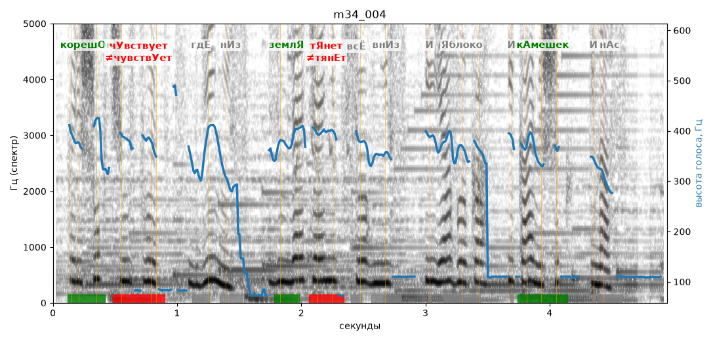

# m34_004

Голос: **Серия 34, Пик (31.9 с), голос iPhone** · длительность 4.9 с
Естественность (UTMOS): **1.26 из 5** (живой диктор ≈ 4–4.5)
Эталон: Корешок чувствует, где низ. Земля тянет всё вниз — и яблоко, и камешек, и нас.
Распознано: Корешок чувствует где низ, земля тянет всё вниз, и я в экаф и камешек и нас.
Расхождения в словах: «яблоко» → «я в экаф»

## Ударения
(где нужно: ruaccent)

| слово | нужно | у голоса | |
|---|---|---|---|
| корешок | корешОк | корешОк | ✓ |
| чувствует | чУвствует | чувствУет | ✗ ОШИБКА |
| земля | землЯ | землЯ | ✓ |
| тянет | тЯнет | тянЕт | ✗ ОШИБКА |
| яблоко | Яблоко | — | ? |
| камешек | кАмешек | кАмешек | ✓ |

## Интонация
- ✓ «корешок чувствует где низ.» — конец фразы понижается — звучит законченно
- ✓ «земля тянет всё вниз и яблоко и камешек и нас.» — конец фразы понижается — звучит законченно
- Диапазон голоса 27.6 полутонов (живо), средняя высота 342 Гц

## Паузы и темп
- паузы на своих местах
- Темп 6.9 слога/с (быстро)

_Синяя линия — высота голоса. Над словами заглавная буква — где ударение должно быть; красным — голос поставил не туда (уверенно), оранжевым — возможно._
