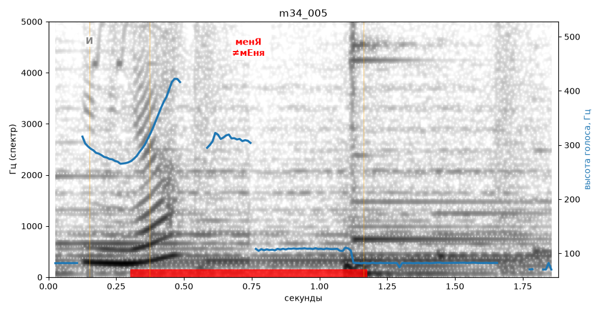

# m34_005

Голос: **Серия 34, Рон (36.8 с), голос iPhone** · длительность 1.9 с
Естественность (UTMOS): **1.31 из 5** (живой диктор ≈ 4–4.5)
Эталон: И меня?
Распознано: И меня?
Слова: все совпали

## Ударения
(где нужно: ruaccent)

| слово | нужно | у голоса | |
|---|---|---|---|
| меня | менЯ | мЕня | ✗ ОШИБКА |

## Интонация
- ✗ «и меня?» — нет вопросительного подъёма (самое высокое место — «и», в начале) — звучит как утверждение
- Диапазон голоса 25.5 полутонов (живо), средняя высота 108 Гц

## Паузы и темп
- паузы на своих местах
- Темп 2.9 слога/с (медленно)

_Синяя линия — высота голоса. Над словами заглавная буква — где ударение должно быть; красным — голос поставил не туда (уверенно), оранжевым — возможно._
