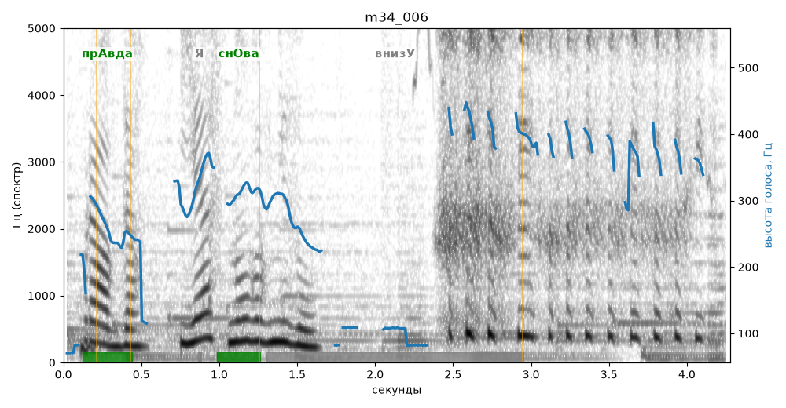

# m34_006

Голос: **Серия 34, Рон (38.6 с), голос iPhone** · длительность 4.3 с
Естественность (UTMOS): **1.38 из 5** (живой диктор ≈ 4–4.5)
Эталон: Правда! Я снова внизу.
Распознано: Правда, я снова внизу.
Слова: все совпали

## Ударения
(где нужно: ruaccent)

| слово | нужно | у голоса | |
|---|---|---|---|
| правда | прАвда | прАвда | ✓ |
| снова | снОва | снОва | ✓ |
| внизу | внизУ | внИзу | ? не разобрать |

## Интонация
- ✗ «я снова внизу.» — конец фразы не понижается — звучит незаконченно / как перечисление
- Диапазон голоса 27.9 полутонов (живо), средняя высота 297 Гц

## Паузы и темп
- паузы на своих местах
- Темп 2.5 слога/с (медленно)

_Синяя линия — высота голоса. Над словами заглавная буква — где ударение должно быть; красным — голос поставил не туда (уверенно), оранжевым — возможно._
