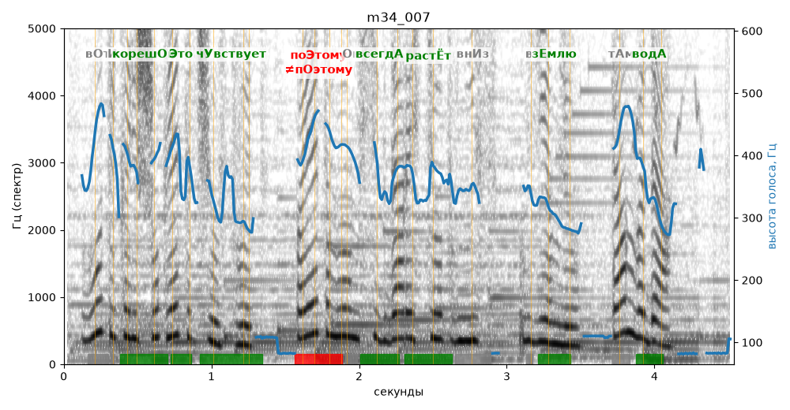

# m34_007

Голос: **Серия 34, Пик (42.9 с), голос iPhone** · длительность 4.5 с
Естественность (UTMOS): **1.25 из 5** (живой диктор ≈ 4–4.5)
Эталон: Вот и корешок это чувствует. Поэтому он всегда растёт вниз, в землю. Там вода.
Распознано: Вот и кальшок это чувствует, поэтому он всегда растет вниз, на землю. Там вода.
Расхождения в словах: «корешок» → «кальшок»; «в» → «на»

## Ударения
(где нужно: ruaccent)

| слово | нужно | у голоса | |
|---|---|---|---|
| корешок | корешОк | корешОк | ✓ |
| это | Это | Это | ✓ |
| чувствует | чУвствует | чУвствует | ✓ |
| поэтому | поЭтому | пОэтому | ✗ ОШИБКА |
| всегда | всегдА | всегдА | ✓ |
| растёт | растЁт | растЁт | ✓ |
| землю | зЕмлю | зЕмлю | ✓ |
| вода | водА | водА | ✓ |

## Интонация
- ✓ «вот и корешок это чувствует.» — конец фразы понижается — звучит законченно
- ✓ «поэтому он всегда растёт вниз в землю.» — конец фразы понижается — звучит законченно
- ✓ «там вода.» — конец фразы понижается — звучит законченно
- Диапазон голоса 29.5 полутонов (живо), средняя высота 340 Гц

## Паузы и темп
- паузы на своих местах
- Темп 8.2 слога/с (быстро)

_Синяя линия — высота голоса. Над словами заглавная буква — где ударение должно быть; красным — голос поставил не туда (уверенно), оранжевым — возможно._
