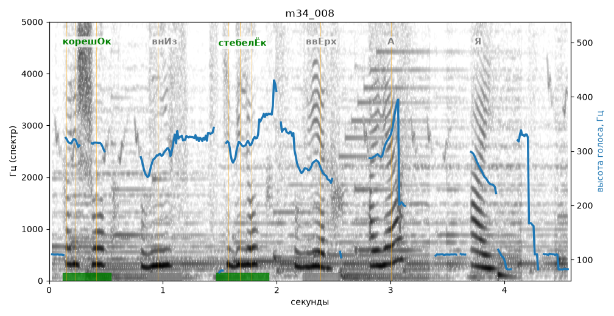

# m34_008

Голос: **Серия 34, Рон (50.9 с), голос iPhone** · длительность 4.6 с
Естественность (UTMOS): **1.29 из 5** (живой диктор ≈ 4–4.5)
Эталон: Корешок — вниз, стебелёк — вверх. А я?
Распознано: Корешок вниз, стебелек вверх. А я Ай.
Расхождения в словах: «» → «ай»

## Ударения
(где нужно: ruaccent)

| слово | нужно | у голоса | |
|---|---|---|---|
| корешок | корешОк | корешОк | ✓ |
| стебелёк | стебелЁк | стебелЁк | ✓ |

## Интонация
- ✓ «корешок вниз стебелёк вверх.» — конец фразы понижается — звучит законченно
- Диапазон голоса 25.5 полутонов (живо), средняя высота 290 Гц

## Паузы и темп
- лишняя пауза 0.74 с между «а» и «я»
- Темп 5.8 слога/с (нормально)

_Синяя линия — высота голоса. Над словами заглавная буква — где ударение должно быть; красным — голос поставил не туда (уверенно), оранжевым — возможно._
