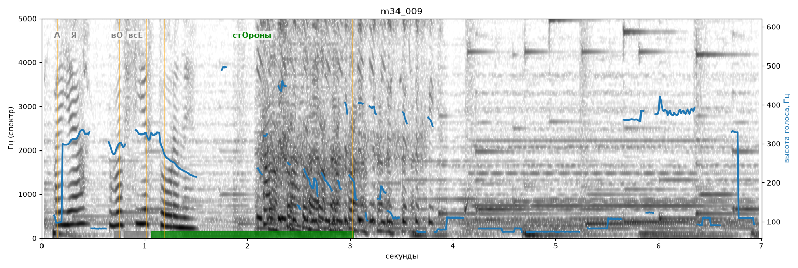

# m34_009

Голос: **Серия 34, Рон (55.4 с), голос iPhone** · длительность 7.0 с
Естественность (UTMOS): **1.24 из 5** (живой диктор ≈ 4–4.5)
Эталон: А я — во все стороны!
Распознано: А я во все стороны.
Слова: все совпали

## Ударения
(где нужно: ruaccent)

| слово | нужно | у голоса | |
|---|---|---|---|
| стороны | стОроны | стОроны | ✓ |

## Интонация
- ✓ «а я во все стороны!» — выделено слово «все» (+4.0 пт)
- Диапазон голоса 29.1 полутонов (живо), средняя высота 159 Гц

## Паузы и темп
- паузы на своих местах
- Темп 2.4 слога/с (медленно)

_Синяя линия — высота голоса. Над словами заглавная буква — где ударение должно быть; красным — голос поставил не туда (уверенно), оранжевым — возможно._
