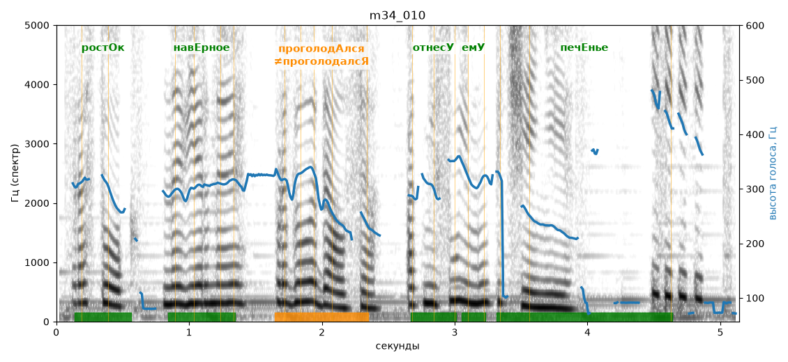

# m34_010

Голос: **Серия 34, Рон (71.6 с), голос iPhone** · длительность 5.1 с
Естественность (UTMOS): **1.81 из 5** (живой диктор ≈ 4–4.5)
Эталон: Росток, наверное, проголодался. Отнесу ему печенье!
Распознано: Росток, наверное, проголодался, отнесу ему печенье.
Слова: все совпали

## Ударения
(где нужно: ruaccent)

| слово | нужно | у голоса | |
|---|---|---|---|
| росток | ростОк | ростОк | ✓ |
| наверное | навЕрное | навЕрное | ✓ |
| проголодался | проголодАлся | проголодалсЯ | ✗? возможно — послушать |
| отнесу | отнесУ | отнесУ | ✓ |
| ему | емУ | емУ | ✓ |
| печенье | печЕнье | печЕнье | ✓ |

## Интонация
- ✓ «росток наверное проголодался.» — конец фразы понижается — звучит законченно
- ✗ «отнесу ему печенье!» — восклицание звучит ровно, без эмоции
- Диапазон голоса 27.9 полутонов (живо), средняя высота 297 Гц

## Паузы и темп
- паузы на своих местах
- Темп 5.3 слога/с (нормально)

_Синяя линия — высота голоса. Над словами заглавная буква — где ударение должно быть; красным — голос поставил не туда (уверенно), оранжевым — возможно._
