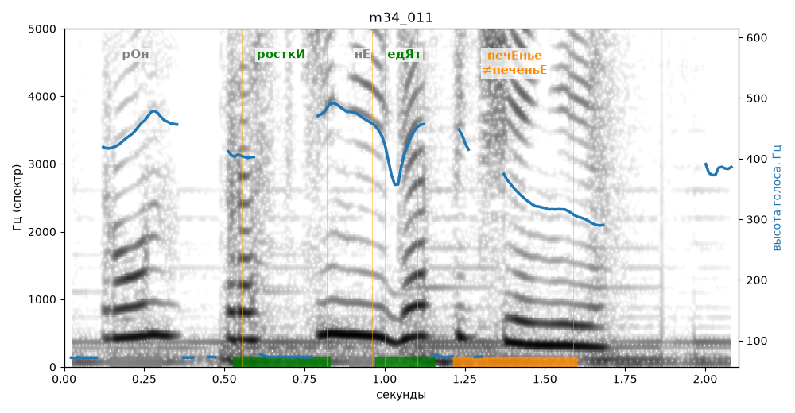

# m34_011

Голос: **Серия 34, Пик (76.7 с), голос iPhone** · длительность 2.1 с
Естественность (UTMOS): **1.35 из 5** (живой диктор ≈ 4–4.5)
Эталон: Рон, ростки не едят печенье.
Распознано: Рон, простите, не идёт печенье.
Расхождения в словах: «ростки» → «простите»; «едят» → «идет»

## Ударения
(где нужно: ruaccent)

| слово | нужно | у голоса | |
|---|---|---|---|
| ростки | росткИ | росткИ | ✓ |
| едят | едЯт | едЯт | ✓ |
| печенье | печЕнье | печеньЕ | ✗? возможно — послушать |

## Интонация
- ✓ «рон ростки не едят печенье.» — конец фразы понижается — звучит законченно
- Диапазон голоса 32.8 полутонов (живо), средняя высота 373 Гц

## Паузы и темп
- паузы на своих местах
- Темп 7.3 слога/с (быстро)

_Синяя линия — высота голоса. Над словами заглавная буква — где ударение должно быть; красным — голос поставил не туда (уверенно), оранжевым — возможно._
