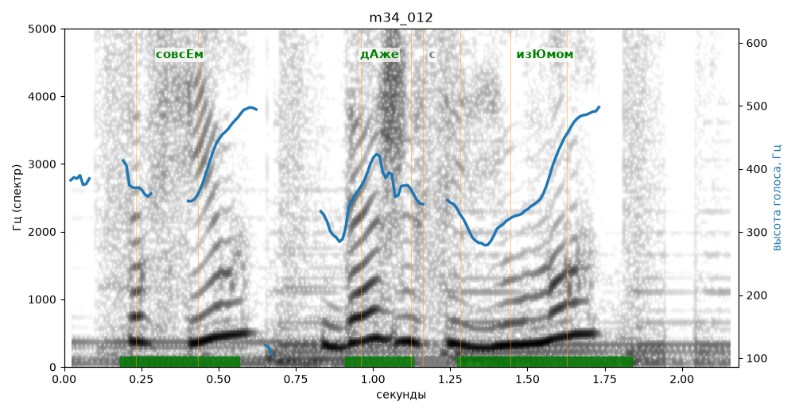

# m34_012

Голос: **Серия 34, Рон (78.8 с), голос iPhone** · длительность 2.2 с
Естественность (UTMOS): **1.41 из 5** (живой диктор ≈ 4–4.5)
Эталон: Совсем? Даже с изюмом?
Распознано: Совсем? Даже со зимы?
Расхождения в словах: «с изюмом» → «со зимы»

## Ударения
(где нужно: ruaccent)

| слово | нужно | у голоса | |
|---|---|---|---|
| совсем | совсЕм | совсЕм | ✓ |
| даже | дАже | дАже | ✓ |
| изюмом | изЮмом | изЮмом | ✓ |

## Интонация
- ✗ «даже с изюмом?» — нет вопросительного подъёма (самое высокое место — «даже», в начале) — звучит как утверждение
- Диапазон голоса 9.5 полутонов (живо), средняя высота 369 Гц

## Паузы и темп
- паузы на своих местах
- Темп 6.1 слога/с (нормально)

_Синяя линия — высота голоса. Над словами заглавная буква — где ударение должно быть; красным — голос поставил не туда (уверенно), оранжевым — возможно._
