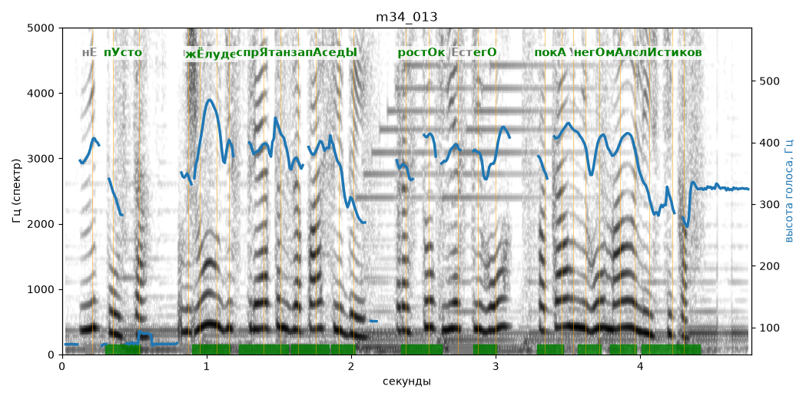

# m34_013

Голос: **Серия 34, Пик (86.3 с), голос iPhone** · длительность 4.8 с
Естественность (UTMOS): **1.25 из 5** (живой диктор ≈ 4–4.5)
Эталон: Не пусто. В жёлуде спрятан запас еды. Росток ест его, пока у него мало листиков.
Распознано: Не пусто. В желуде спрятан запас еды. Просток есть его, пока у него мало листиков.
Расхождения в словах: «росток ест» → «просток есть»

## Ударения
(где нужно: ruaccent)

| слово | нужно | у голоса | |
|---|---|---|---|
| пусто | пУсто | пУсто | ✓ |
| жёлуде | жЁлуде | жЁлуде | ✓ |
| спрятан | спрЯтан | спрЯтан | ✓ |
| запас | запАс | запАс | ✓ |
| еды | едЫ | едЫ | ✓ |
| росток | ростОк | ростОк | ✓ |
| его | егО | егО | ✓ |
| пока | покА | покА | ✓ |
| него | негО | негО | ✓ |
| мало | мАло | мАло | ✓ |
| листиков | лИстиков | лИстиков | ✓ |

## Интонация
- ✗ «не пусто.» — конец фразы не понижается — звучит незаконченно / как перечисление
- ✓ «в жёлуде спрятан запас еды.» — конец фразы понижается — звучит законченно
- ✓ «росток ест его пока у него мало листиков.» — конец фразы понижается — звучит законченно
- Диапазон голоса 30.5 полутонов (живо), средняя высота 366 Гц

## Паузы и темп
- паузы на своих местах
- Темп 8.4 слога/с (быстро)

_Синяя линия — высота голоса. Над словами заглавная буква — где ударение должно быть; красным — голос поставил не туда (уверенно), оранжевым — возможно._
