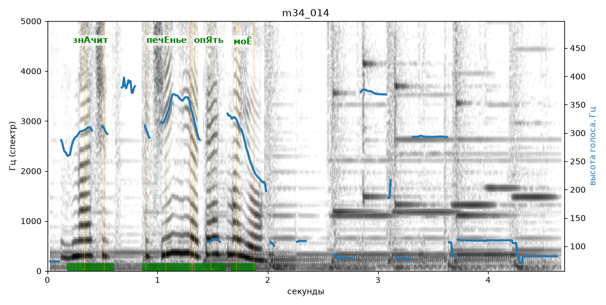

# m34_014

Голос: **Серия 34, Рон (95.8 с), голос iPhone** · длительность 4.7 с
Естественность (UTMOS): **1.47 из 5** (живой диктор ≈ 4–4.5)
Эталон: Значит, печенье опять моё.
Распознано: Значит, печенье опять мое.
Слова: все совпали

## Ударения
(где нужно: ruaccent)

| слово | нужно | у голоса | |
|---|---|---|---|
| значит | знАчит | знАчит | ✓ |
| печенье | печЕнье | печЕнье | ✓ |
| опять | опЯть | опЯть | ✓ |
| моё | моЁ | моЁ | ✓ |

## Интонация
- ✓ «значит печенье опять моё.» — конец фразы понижается — звучит законченно
- Диапазон голоса 27.1 полутонов (живо), средняя высота 223 Гц

## Паузы и темп
- паузы на своих местах
- Темп 6.2 слога/с (нормально)

_Синяя линия — высота голоса. Над словами заглавная буква — где ударение должно быть; красным — голос поставил не туда (уверенно), оранжевым — возможно._
