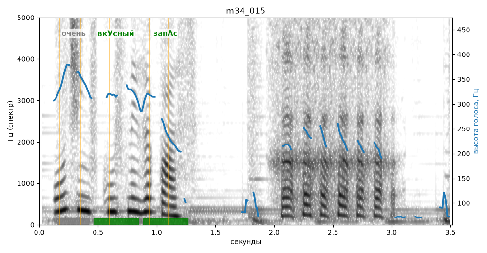

# m34_015

Голос: **Серия 34, Рон (100.4 с), голос iPhone** · длительность 3.5 с
Естественность (UTMOS): **1.67 из 5** (живой диктор ≈ 4–4.5)
Эталон: Очень вкусный запас.
Распознано: Очень вкусный запас!
Слова: все совпали

## Ударения
(где нужно: ruaccent)

| слово | нужно | у голоса | |
|---|---|---|---|
| очень | очень | Очень | нет эталона |
| вкусный | вкУсный | вкУсный | ✓ |
| запас | запАс | запАс | ✓ |

## Интонация
- ✓ «очень вкусный запас.» — конец фразы понижается — звучит законченно
- Диапазон голоса 27.7 полутонов (живо), средняя высота 235 Гц

## Паузы и темп
- паузы на своих местах
- Темп 5.4 слога/с (нормально)

_Синяя линия — высота голоса. Над словами заглавная буква — где ударение должно быть; красным — голос поставил не туда (уверенно), оранжевым — возможно._
