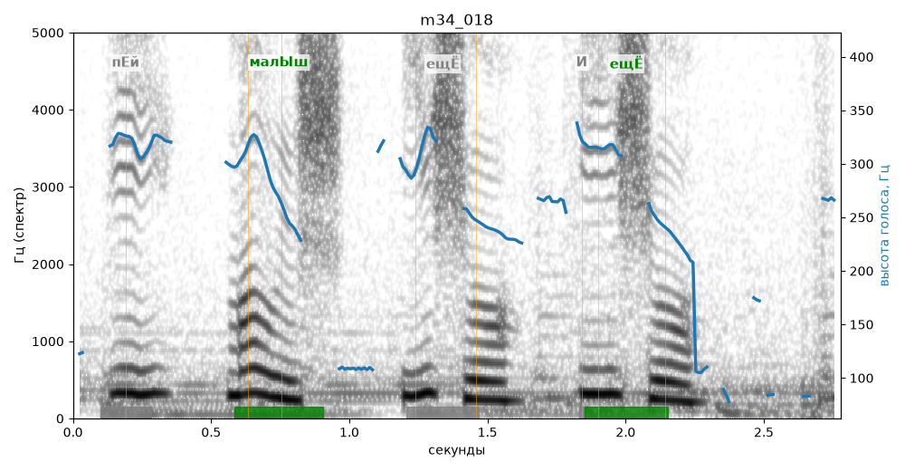

# m34_018

Голос: **Серия 34, Рон (118.4 с), голос iPhone** · длительность 2.8 с
Естественность (UTMOS): **2.22 из 5** (живой диктор ≈ 4–4.5)
Эталон: Пей, малыш! Ещё! И ещё!
Распознано: Би, малыш, еще, еще!
Расхождения в словах: «пей» → «би»; «и» → «»

## Ударения
(где нужно: ruaccent)

| слово | нужно | у голоса | |
|---|---|---|---|
| малыш | малЫш | малЫш | ✓ |
| ещё | ещЁ | Ещё | ? не разобрать |
| ещё | ещЁ | ещЁ | ✓ |

## Интонация
- ✗ «пей малыш!» — восклицание звучит ровно, без эмоции
- ✗ «и ещё!» — восклицание звучит ровно, без эмоции
- Диапазон голоса 20.9 полутонов (живо), средняя высота 266 Гц

## Паузы и темп
- паузы на своих местах
- Темп 7.4 слога/с (быстро)

_Синяя линия — высота голоса. Над словами заглавная буква — где ударение должно быть; красным — голос поставил не туда (уверенно), оранжевым — возможно._
