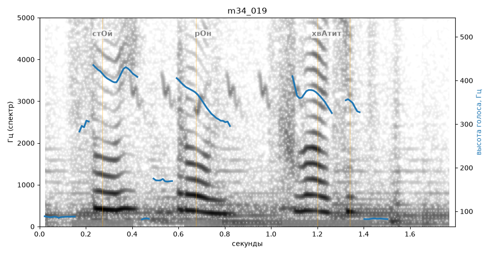

# m34_019

Голос: **Серия 34, Пик (121.1 с), голос iPhone** · длительность 1.8 с
Естественность (UTMOS): **1.35 из 5** (живой диктор ≈ 4–4.5)
Эталон: Стой, Рон! Хватит!
Распознано: Стой, трон, хватит!
Расхождения в словах: «рон» → «трон»

## Ударения
(где нужно: ruaccent)

| слово | нужно | у голоса | |
|---|---|---|---|
| хватит | хвАтит | хватИт | ? не разобрать |

## Интонация
- Диапазон голоса 28.3 полутонов (живо), средняя высота 332 Гц

## Паузы и темп
- паузы на своих местах
- Темп 5.0 слога/с (нормально)

_Синяя линия — высота голоса. Над словами заглавная буква — где ударение должно быть; красным — голос поставил не туда (уверенно), оранжевым — возможно._
