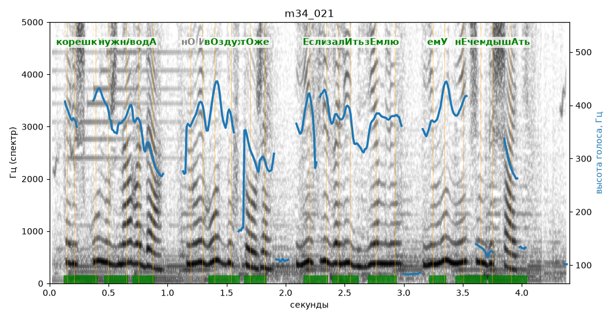

# m34_021

Голос: **Серия 34, Пик (127.3 с), голос iPhone** · длительность 4.4 с
Естественность (UTMOS): **1.26 из 5** (живой диктор ≈ 4–4.5)
Эталон: Корешку нужна вода. Но и воздух тоже. Если залить землю, ему нечем дышать.
Распознано: Кришку нужна вода, но и воздух тоже. Если залить землю, ему нечем дышать.
Расхождения в словах: «корешку» → «кришку»

## Ударения
(где нужно: ruaccent)

| слово | нужно | у голоса | |
|---|---|---|---|
| корешку | корешкУ | корешкУ | ✓ |
| нужна | нужнА | нужнА | ✓ |
| вода | водА | водА | ✓ |
| воздух | вОздух | вОздух | ✓ |
| тоже | тОже | тОже | ✓ |
| если | Если | Если | ✓ |
| залить | залИть | залИть | ✓ |
| землю | зЕмлю | зЕмлю | ✓ |
| ему | емУ | емУ | ✓ |
| нечем | нЕчем | нЕчем | ✓ |
| дышать | дышАть | дышАть | ✓ |

## Интонация
- ✓ «корешку нужна вода.» — конец фразы понижается — звучит законченно
- ✓ «но и воздух тоже.» — конец фразы понижается — звучит законченно
- ✓ «если залить землю ему нечем дышать.» — конец фразы понижается — звучит законченно
- Диапазон голоса 24.7 полутонов (живо), средняя высота 365 Гц

## Паузы и темп
- паузы на своих местах
- Темп 8.2 слога/с (быстро)

_Синяя линия — высота голоса. Над словами заглавная буква — где ударение должно быть; красным — голос поставил не туда (уверенно), оранжевым — возможно._
