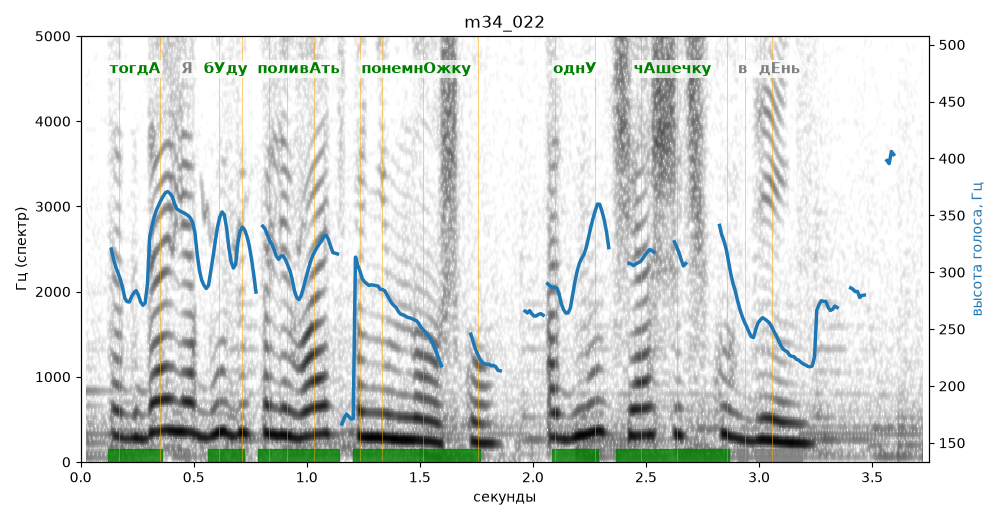

# m34_022

Голос: **Серия 34, Рон (137.0 с), голос iPhone** · длительность 3.8 с
Естественность (UTMOS): **1.92 из 5** (живой диктор ≈ 4–4.5)
Эталон: Тогда я буду поливать понемножку. Одну чашечку в день.
Распознано: тогда я буду поливать по немножко одну чашечку в день
Расхождения в словах: «понемножку» → «по немножко»

## Ударения
(где нужно: ruaccent)

| слово | нужно | у голоса | |
|---|---|---|---|
| тогда | тогдА | тогдА | ✓ |
| буду | бУду | бУду | ✓ |
| поливать | поливАть | поливАть | ✓ |
| понемножку | понемнОжку | понемнОжку | ✓ |
| одну | однУ | однУ | ✓ |
| чашечку | чАшечку | чАшечку | ✓ |

## Интонация
- ✓ «тогда я буду поливать понемножку.» — конец фразы понижается — звучит законченно
- ✓ «одну чашечку в день.» — конец фразы понижается — звучит законченно
- Диапазон голоса 8.5 полутонов (живо), средняя высота 288 Гц

## Паузы и темп
- паузы на своих местах
- Темп 6.6 слога/с (быстро)

_Синяя линия — высота голоса. Над словами заглавная буква — где ударение должно быть; красным — голос поставил не туда (уверенно), оранжевым — возможно._
