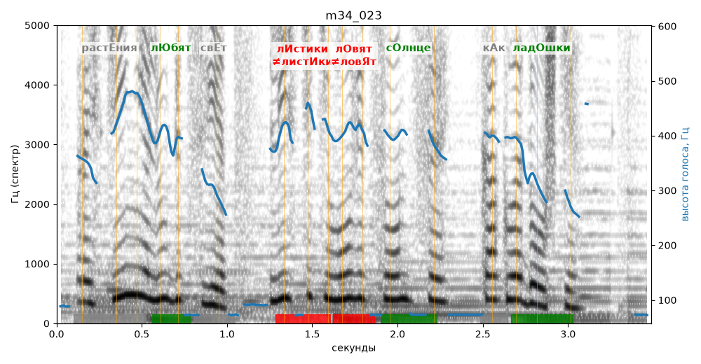

# m34_023

Голос: **Серия 34, Пик (148.0 с), голос iPhone** · длительность 3.5 с
Естественность (UTMOS): **1.3 из 5** (живой диктор ≈ 4–4.5)
Эталон: Растения любят свет. Листики ловят солнце, как ладошки.
Распознано: Простение любит свет. Листики ловят солнце, как ладошки.
Расхождения в словах: «растения любят» → «простение любит»

## Ударения
(где нужно: ruaccent)

| слово | нужно | у голоса | |
|---|---|---|---|
| растения | растЕния | — | ? |
| любят | лЮбят | лЮбят | ✓ |
| листики | лИстики | листИки | ✗ ОШИБКА |
| ловят | лОвят | ловЯт | ✗ ОШИБКА |
| солнце | сОлнце | сОлнце | ✓ |
| ладошки | ладОшки | ладОшки | ✓ |

## Интонация
- ✓ «растения любят свет.» — конец фразы понижается — звучит законченно
- ✓ «листики ловят солнце как ладошки.» — конец фразы понижается — звучит законченно
- Диапазон голоса 31.9 полутонов (живо), средняя высота 360 Гц

## Паузы и темп
- паузы на своих местах
- Темп 7.0 слога/с (быстро)

_Синяя линия — высота голоса. Над словами заглавная буква — где ударение должно быть; красным — голос поставил не туда (уверенно), оранжевым — возможно._
