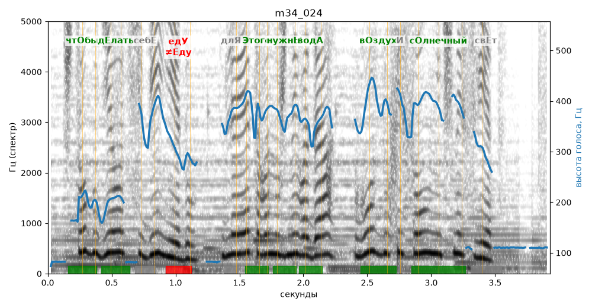

# m34_024

Голос: **Серия 34, Пик (153.0 с), голос iPhone** · длительность 3.9 с
Естественность (UTMOS): **1.27 из 5** (живой диктор ≈ 4–4.5)
Эталон: Чтобы делать себе еду. Для этого нужны вода, воздух и солнечный свет.
Распознано: Чтобы делать себе еду, для этого нужна вода, воздух и солнечный свет.
Расхождения в словах: «нужны» → «нужна»

## Ударения
(где нужно: ruaccent)

| слово | нужно | у голоса | |
|---|---|---|---|
| чтобы | чтОбы | чтОбы | ✓ |
| делать | дЕлать | дЕлать | ✓ |
| себе | себЕ | сЕбе | ? не разобрать |
| еду | едУ | Еду | ✗ ОШИБКА |
| этого | Этого | Этого | ✓ |
| нужны | нужнЫ | нужнЫ | ✓ |
| вода | водА | водА | ✓ |
| воздух | вОздух | вОздух | ✓ |
| солнечный | сОлнечный | сОлнечный | ✓ |

## Интонация
- ✗ «чтобы делать себе еду.» — конец фразы не понижается — звучит незаконченно / как перечисление
- ✓ «для этого нужны вода воздух и солнечный свет.» — конец фразы понижается — звучит законченно
- Диапазон голоса 28.0 полутонов (живо), средняя высота 337 Гц

## Паузы и темп
- паузы на своих местах
- Темп 8.1 слога/с (быстро)

_Синяя линия — высота голоса. Над словами заглавная буква — где ударение должно быть; красным — голос поставил не туда (уверенно), оранжевым — возможно._
