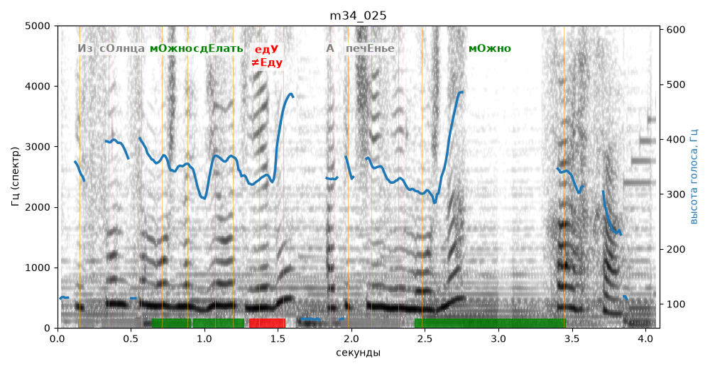

# m34_025

Голос: **Серия 34, Рон (156.9 с), голос iPhone** · длительность 4.1 с
Естественность (UTMOS): **1.45 из 5** (живой диктор ≈ 4–4.5)
Эталон: Из солнца можно сделать еду? А печенье можно?
Распознано: И солнце можно сделать еду, а печенье можно? Хаха!
Расхождения в словах: «из солнца» → «и солнце»; «» → «хаха»

## Ударения
(где нужно: ruaccent)

| слово | нужно | у голоса | |
|---|---|---|---|
| солнца | сОлнца | солнцА | ? не разобрать |
| можно | мОжно | мОжно | ✓ |
| сделать | сдЕлать | сдЕлать | ✓ |
| еду | едУ | Еду | ✗ ОШИБКА |
| печенье | печЕнье | печеньЕ | ? не разобрать |
| можно | мОжно | мОжно | ✓ |

## Интонация
- ✓ «из солнца можно сделать еду?» — вопросительный подъём на слове «еду»
- ✗ «а печенье можно?» — нет вопросительного подъёма (самое высокое место — «печенье», в начале) — звучит как утверждение
- Диапазон голоса 31.3 полутонов (живо), средняя высота 335 Гц

## Паузы и темп
- паузы на своих местах
- Темп 5.0 слога/с (нормально)

_Синяя линия — высота голоса. Над словами заглавная буква — где ударение должно быть; красным — голос поставил не туда (уверенно), оранжевым — возможно._
