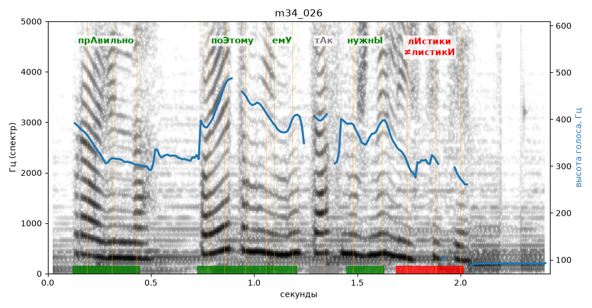

# m34_026

Голос: **Серия 34, Пик (170.0 с), голос iPhone** · длительность 2.4 с
Естественность (UTMOS): **1.28 из 5** (живой диктор ≈ 4–4.5)
Эталон: Правильно. Поэтому ему так нужны листики.
Распознано: Правильно, поэтому ему так нужны листики.
Слова: все совпали

## Ударения
(где нужно: ruaccent)

| слово | нужно | у голоса | |
|---|---|---|---|
| правильно | прАвильно | прАвильно | ✓ |
| поэтому | поЭтому | поЭтому | ✓ |
| ему | емУ | емУ | ✓ |
| нужны | нужнЫ | нужнЫ | ✓ |
| листики | лИстики | листикИ | ✗ ОШИБКА |

## Интонация
- ✗ «правильно.» — конец фразы не понижается — звучит незаконченно / как перечисление
- ✓ «поэтому ему так нужны листики.» — конец фразы понижается — звучит законченно
- Диапазон голоса 27.0 полутонов (живо), средняя высота 323 Гц

## Паузы и темп
- паузы на своих местах
- Темп 9.3 слога/с (быстро)

_Синяя линия — высота голоса. Над словами заглавная буква — где ударение должно быть; красным — голос поставил не туда (уверенно), оранжевым — возможно._
