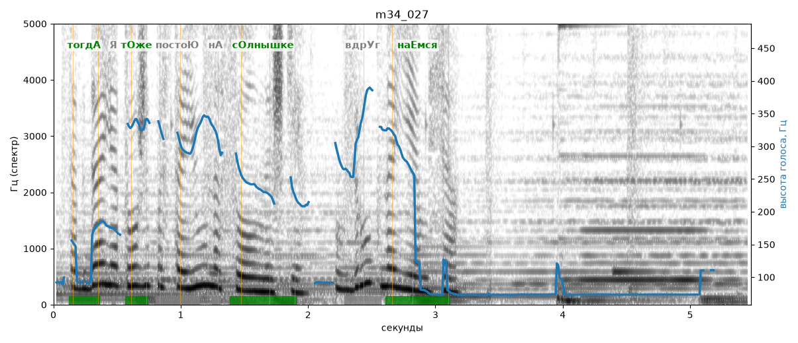

# m34_027

Голос: **Серия 34, Рон (172.4 с), голос iPhone** · длительность 5.5 с
Естественность (UTMOS): **1.31 из 5** (живой диктор ≈ 4–4.5)
Эталон: Тогда я тоже постою на солнышке. Вдруг наемся.
Распознано: Тогда я тоже постою на солнышке, вдруг наемся.
Слова: все совпали

## Ударения
(где нужно: ruaccent)

| слово | нужно | у голоса | |
|---|---|---|---|
| тогда | тогдА | тогдА | ✓ |
| тоже | тОже | тОже | ✓ |
| постою | постоЮ | — | ? |
| солнышке | сОлнышке | сОлнышке | ✓ |
| наемся | наЕмся | наЕмся | ✓ |

## Интонация
- ✓ «тогда я тоже постою на солнышке.» — конец фразы понижается — звучит законченно
- ✓ «вдруг наемся.» — конец фразы понижается — звучит законченно
- Диапазон голоса 26.5 полутонов (живо), средняя высота 92 Гц

## Паузы и темп
- паузы на своих местах
- Темп 5.4 слога/с (нормально)

_Синяя линия — высота голоса. Над словами заглавная буква — где ударение должно быть; красным — голос поставил не туда (уверенно), оранжевым — возможно._
