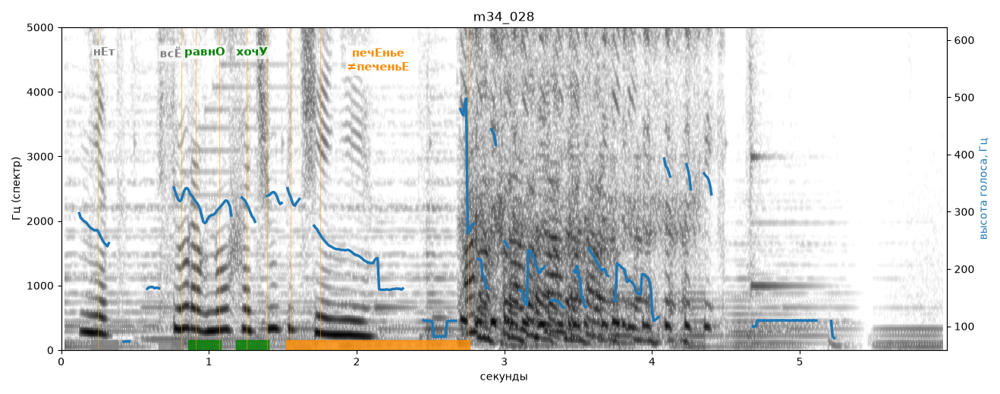

# m34_028

Голос: **Серия 34, Рон (177.8 с), голос iPhone** · длительность 6.0 с
Естественность (UTMOS): **1.26 из 5** (живой диктор ≈ 4–4.5)
Эталон: Нет. Всё равно хочу печенье.
Распознано: Нет, всё равно хочу печенье.
Слова: все совпали

## Ударения
(где нужно: ruaccent)

| слово | нужно | у голоса | |
|---|---|---|---|
| равно | равнО | равнО | ✓ |
| хочу | хочУ | хочУ | ✓ |
| печенье | печЕнье | печеньЕ | ✗? возможно — послушать |

## Интонация
- ✓ «всё равно хочу печенье.» — конец фразы понижается — звучит законченно
- Диапазон голоса 22.3 полутонов (живо), средняя высота 210 Гц

## Паузы и темп
- паузы на своих местах
- Темп 3.9 слога/с (медленно)

_Синяя линия — высота голоса. Над словами заглавная буква — где ударение должно быть; красным — голос поставил не туда (уверенно), оранжевым — возможно._
