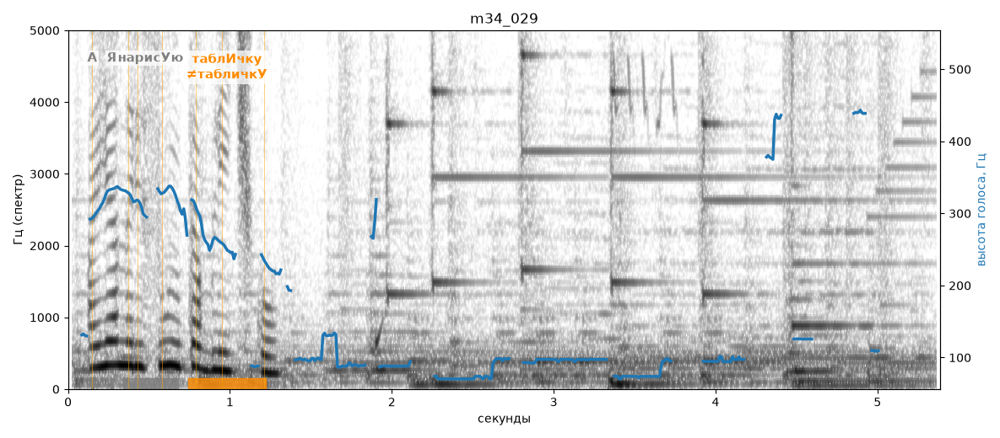

# m34_029

Голос: **Серия 34, Рон (195.5 с), голос iPhone** · длительность 5.4 с
Естественность (UTMOS): **1.33 из 5** (живой диктор ≈ 4–4.5)
Эталон: А я нарисую табличку!
Распознано: А я нарисую табличку.
Слова: все совпали

## Ударения
(где нужно: ruaccent)

| слово | нужно | у голоса | |
|---|---|---|---|
| нарисую | нарисУю | — | ? |
| табличку | таблИчку | табличкУ | ✗? возможно — послушать |

## Интонация
- ✗ «а я нарисую табличку!» — восклицание звучит ровно, без эмоции
- Диапазон голоса 27.2 полутонов (живо), средняя высота 98 Гц

## Паузы и темп
- паузы на своих местах
- Темп 6.5 слога/с (нормально)

_Синяя линия — высота голоса. Над словами заглавная буква — где ударение должно быть; красным — голос поставил не туда (уверенно), оранжевым — возможно._
