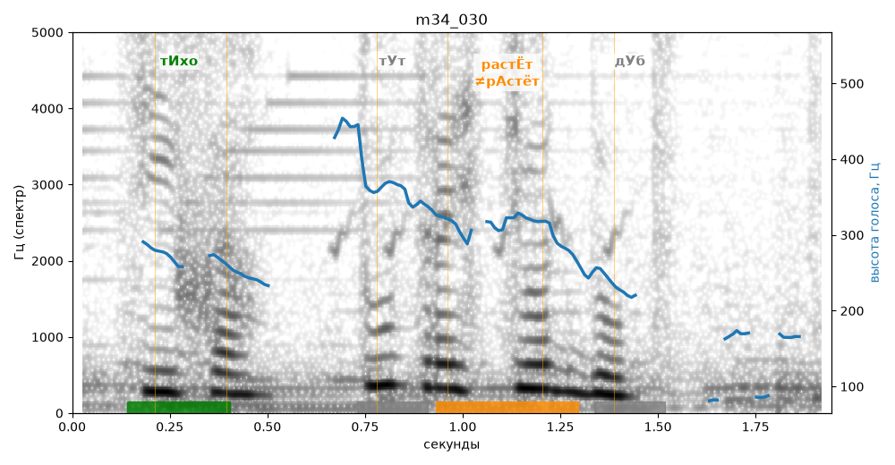

# m34_030

Голос: **Серия 34, Рон (200.8 с), голос iPhone** · длительность 1.9 с
Естественность (UTMOS): **1.62 из 5** (живой диктор ≈ 4–4.5)
Эталон: Тихо! Тут растёт дуб!
Распознано: Тихо, тут растет дуб.
Слова: все совпали

## Ударения
(где нужно: ruaccent)

| слово | нужно | у голоса | |
|---|---|---|---|
| тихо | тИхо | тИхо | ✓ |
| растёт | растЁт | рАстёт | ✗? возможно — послушать |

## Интонация
- ✓ «тут растёт дуб!» — выделено слово «тут» (+2.5 пт)
- Диапазон голоса 26.9 полутонов (живо), средняя высота 280 Гц

## Паузы и темп
- паузы на своих местах
- Темп 5.7 слога/с (нормально)

_Синяя линия — высота голоса. Над словами заглавная буква — где ударение должно быть; красным — голос поставил не туда (уверенно), оранжевым — возможно._
