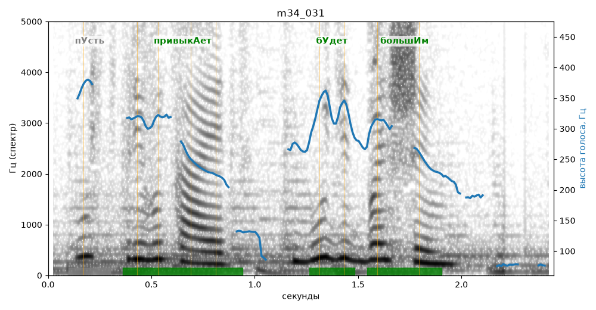

# m34_031

Голос: **Серия 34, Рон (204.5 с), голос iPhone** · длительность 2.4 с
Естественность (UTMOS): **1.49 из 5** (живой диктор ≈ 4–4.5)
Эталон: Пусть привыкает. Будет большим.
Распознано: Пусть привыкает, будет большим.
Слова: все совпали

## Ударения
(где нужно: ruaccent)

| слово | нужно | у голоса | |
|---|---|---|---|
| привыкает | привыкАет | привыкАет | ✓ |
| будет | бУдет | бУдет | ✓ |
| большим | большИм | большИм | ✓ |

## Интонация
- ✓ «пусть привыкает.» — конец фразы понижается — звучит законченно
- ✓ «будет большим.» — конец фразы понижается — звучит законченно
- Диапазон голоса 26.4 полутонов (живо), средняя высота 265 Гц

## Паузы и темп
- паузы на своих местах
- Темп 6.1 слога/с (нормально)

_Синяя линия — высота голоса. Над словами заглавная буква — где ударение должно быть; красным — голос поставил не туда (уверенно), оранжевым — возможно._
