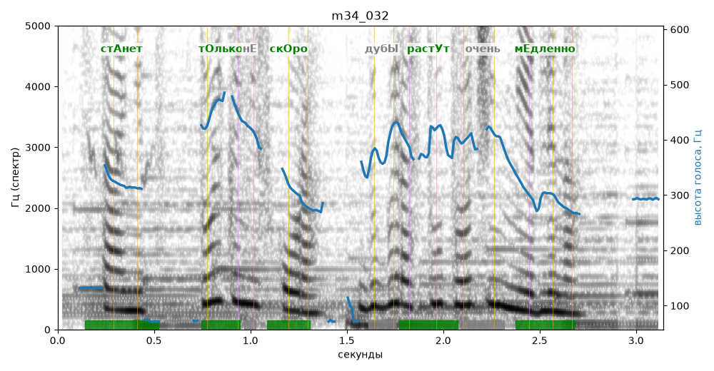

# m34_032

Голос: **Серия 34, Пик (215.9 с), голос iPhone** · длительность 3.1 с
Естественность (UTMOS): **1.28 из 5** (живой диктор ≈ 4–4.5)
Эталон: Станет. Только не скоро. Дубы растут очень медленно.
Распознано: Станет. Только не скоро. Дубы растут очень медленно.
Слова: все совпали

## Ударения
(где нужно: ruaccent)

| слово | нужно | у голоса | |
|---|---|---|---|
| станет | стАнет | стАнет | ✓ |
| только | тОлько | тОлько | ✓ |
| скоро | скОро | скОро | ✓ |
| дубы | дубЫ | дУбы | ? не разобрать |
| растут | растУт | растУт | ✓ |
| очень | очень | Очень | нет эталона |
| медленно | мЕдленно | мЕдленно | ✓ |

## Интонация
- ✓ «только не скоро.» — конец фразы понижается — звучит законченно
- ✓ «дубы растут очень медленно.» — конец фразы понижается — звучит законченно
- Диапазон голоса 31.4 полутонов (живо), средняя высота 327 Гц

## Паузы и темп
- паузы на своих местах
- Темп 7.9 слога/с (быстро)

_Синяя линия — высота голоса. Над словами заглавная буква — где ударение должно быть; красным — голос поставил не туда (уверенно), оранжевым — возможно._
