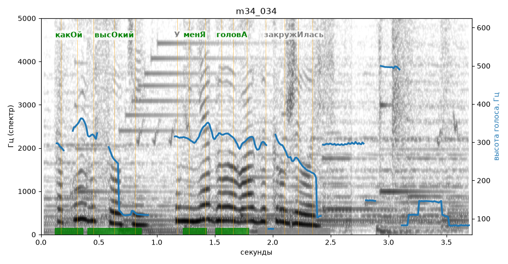

# m34_034

Голос: **Серия 34, Рон (227.9 с), голос iPhone** · длительность 3.7 с
Естественность (UTMOS): **1.32 из 5** (живой диктор ≈ 4–4.5)
Эталон: Какой высокий! У меня голова закружилась.
Распознано: Какой высокий! У меня голова закружилась!
Слова: все совпали

## Ударения
(где нужно: ruaccent)

| слово | нужно | у голоса | |
|---|---|---|---|
| какой | какОй | какОй | ✓ |
| высокий | высОкий | высОкий | ✓ |
| меня | менЯ | менЯ | ✓ |
| голова | головА | головА | ✓ |
| закружилась | закружИлась | закружилАсь | ? не разобрать |

## Интонация
- ✓ «какой высокий!» — выделено слово «какой» (+3.4 пт)
- ✓ «у меня голова закружилась.» — конец фразы понижается — звучит законченно
- Диапазон голоса 31.0 полутонов (живо), средняя высота 293 Гц

## Паузы и темп
- паузы на своих местах
- Темп 7.2 слога/с (быстро)

_Синяя линия — высота голоса. Над словами заглавная буква — где ударение должно быть; красным — голос поставил не туда (уверенно), оранжевым — возможно._
