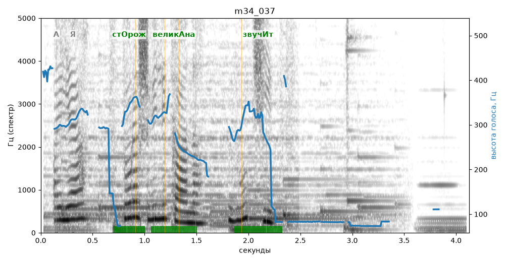

# m34_037

Голос: **Серия 34, Рон (241.2 с), голос iPhone** · длительность 4.1 с
Естественность (UTMOS): **1.37 из 5** (живой диктор ≈ 4–4.5)
Эталон: А я — сторож великана. Звучит!
Распознано: А я, сторож Великана, звучит.
Слова: все совпали

## Ударения
(где нужно: ruaccent)

| слово | нужно | у голоса | |
|---|---|---|---|
| сторож | стОрож | стОрож | ✓ |
| великана | великАна | великАна | ✓ |
| звучит | звучИт | звучИт | ✓ |

## Интонация
- ✓ «а я сторож великана.» — конец фразы понижается — звучит законченно
- Диапазон голоса 27.7 полутонов (живо), средняя высота 242 Гц

## Паузы и темп
- паузы на своих местах
- Темп 6.2 слога/с (нормально)

_Синяя линия — высота голоса. Над словами заглавная буква — где ударение должно быть; красным — голос поставил не туда (уверенно), оранжевым — возможно._
