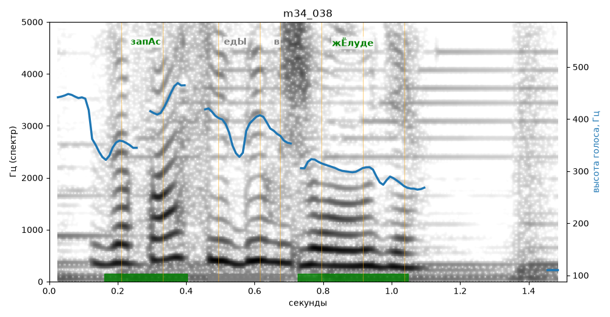

# m34_038

Голос: **Серия 34, Пик (262.3 с), голос iPhone** · длительность 1.5 с
Естественность (UTMOS): **1.7 из 5** (живой диктор ≈ 4–4.5)
Эталон: Запас еды в жёлуде.
Распознано: Запас еды в желуде.
Слова: все совпали

## Ударения
(где нужно: ruaccent)

| слово | нужно | у голоса | |
|---|---|---|---|
| запас | запАс | запАс | ✓ |
| еды | едЫ | Еды | ? не разобрать |
| жёлуде | жЁлуде | жЁлуде | ✓ |

## Интонация
- ✓ «запас еды в жёлуде.» — конец фразы понижается — звучит законченно
- Диапазон голоса 9.1 полутонов (живо), средняя высота 347 Гц

## Паузы и темп
- паузы на своих местах
- Темп 9.0 слога/с (быстро)

_Синяя линия — высота голоса. Над словами заглавная буква — где ударение должно быть; красным — голос поставил не туда (уверенно), оранжевым — возможно._
