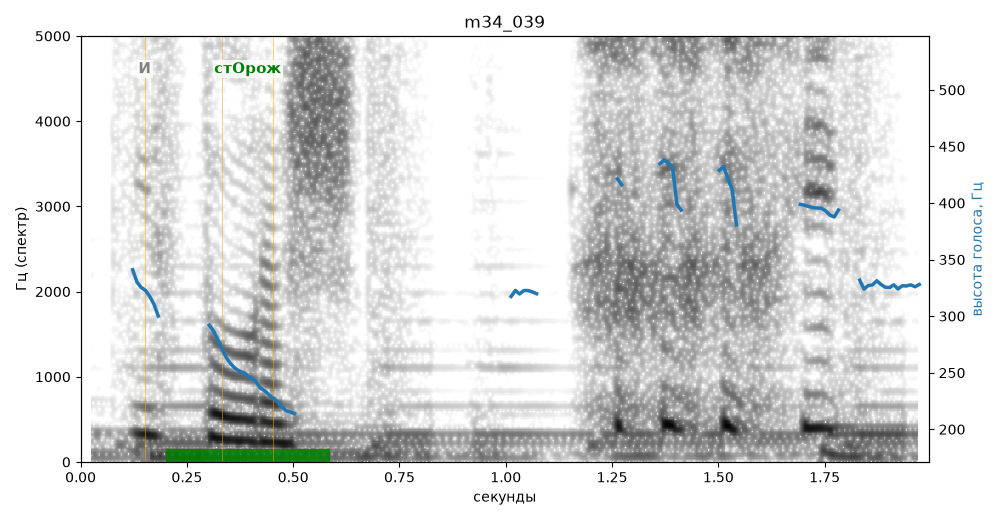

# m34_039

Голос: **Серия 34, Рон (271.9 с), голос iPhone** · длительность 2.0 с
Естественность (UTMOS): **1.34 из 5** (живой диктор ≈ 4–4.5)
Эталон: И сторож!
Распознано: И сторож.
Слова: все совпали

## Ударения
(где нужно: ruaccent)

| слово | нужно | у голоса | |
|---|---|---|---|
| сторож | стОрож | стОрож | ✓ |

## Интонация
- ✓ «и сторож!» — выделено слово «и» (+3.7 пт)
- Диапазон голоса 11.4 полутонов (живо), средняя высота 326 Гц

## Паузы и темп
- паузы на своих местах
- Темп 6.8 слога/с (быстро)

_Синяя линия — высота голоса. Над словами заглавная буква — где ударение должно быть; красным — голос поставил не туда (уверенно), оранжевым — возможно._
