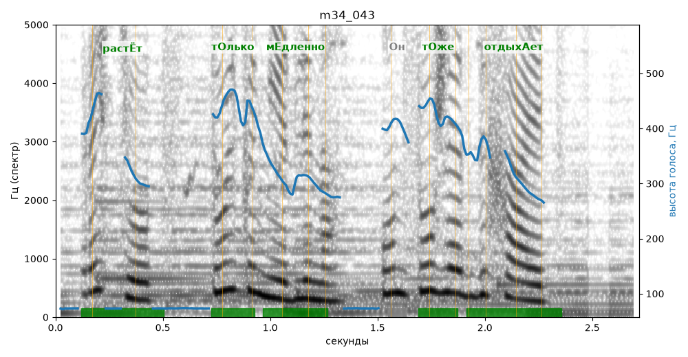

# m34_043

Голос: **Серия 34, Пик (291.5 с), голос iPhone** · длительность 2.7 с
Естественность (UTMOS): **1.27 из 5** (живой диктор ≈ 4–4.5)
Эталон: Растёт. Только медленно. Он тоже отдыхает.
Распознано: Престёт, только медленно. Он тоже отдыхает.
Расхождения в словах: «растет» → «престет»

## Ударения
(где нужно: ruaccent)

| слово | нужно | у голоса | |
|---|---|---|---|
| растёт | растЁт | растЁт | ✓ |
| только | тОлько | тОлько | ✓ |
| медленно | мЕдленно | мЕдленно | ✓ |
| тоже | тОже | тОже | ✓ |
| отдыхает | отдыхАет | отдыхАет | ✓ |

## Интонация
- ✗ «только медленно.» — конец фразы не понижается — звучит незаконченно / как перечисление
- ✓ «он тоже отдыхает.» — конец фразы понижается — звучит законченно
- Диапазон голоса 31.5 полутонов (живо), средняя высота 312 Гц

## Паузы и темп
- паузы на своих местах
- Темп 8.1 слога/с (быстро)

_Синяя линия — высота голоса. Над словами заглавная буква — где ударение должно быть; красным — голос поставил не туда (уверенно), оранжевым — возможно._
