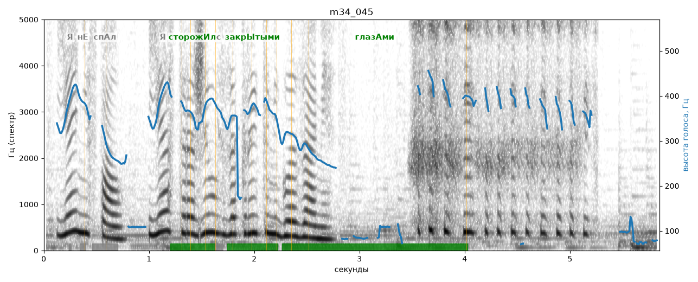

# m34_045

Голос: **Серия 34, Рон (306.2 с), голос iPhone** · длительность 5.8 с
Естественность (UTMOS): **1.36 из 5** (живой диктор ≈ 4–4.5)
Эталон: Я не спал! Я сторожил с закрытыми глазами!
Распознано: Я не спал, я стражилась закрытыми глазами.
Расхождения в словах: «сторожил с» → «стражилась»

## Ударения
(где нужно: ruaccent)

| слово | нужно | у голоса | |
|---|---|---|---|
| сторожил | сторожИл | сторожИл | ✓ |
| закрытыми | закрЫтыми | закрЫтыми | ✓ |
| глазами | глазАми | глазАми | ✓ |

## Интонация
- ✗ «я сторожил с закрытыми глазами!» — восклицание звучит ровно, без эмоции
- Диапазон голоса 28.8 полутонов (живо), средняя высота 340 Гц

## Паузы и темп
- паузы на своих местах
- Темп 3.9 слога/с (медленно)

_Синяя линия — высота голоса. Над словами заглавная буква — где ударение должно быть; красным — голос поставил не туда (уверенно), оранжевым — возможно._
