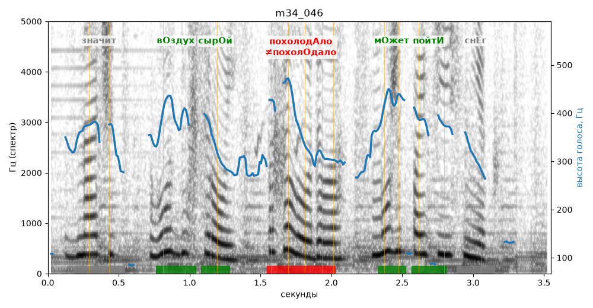

# m34_046

Голос: **Серия 34, Пик (323.5 с), голос iPhone** · длительность 3.5 с
Естественность (UTMOS): **1.24 из 5** (живой диктор ≈ 4–4.5)
Эталон: Значит, воздух сырой. Похолодало. Может пойти снег.
Распознано: Значит, воздух срой, похолодало, может пойти и снег.
Расхождения в словах: «сырой» → «срой»; «» → «и»

## Ударения
(где нужно: ruaccent)

| слово | нужно | у голоса | |
|---|---|---|---|
| значит | значит | знАчит | нет эталона |
| воздух | вОздух | вОздух | ✓ |
| сырой | сырОй | сырОй | ✓ |
| похолодало | похолодАло | похолОдало | ✗ ОШИБКА |
| может | мОжет | мОжет | ✓ |
| пойти | пойтИ | пойтИ | ✓ |

## Интонация
- ✓ «значит воздух сырой.» — конец фразы понижается — звучит законченно
- ✗ «похолодало.» — конец фразы не понижается — звучит незаконченно / как перечисление
- ✓ «может пойти снег.» — конец фразы понижается — звучит законченно
- Диапазон голоса 24.0 полутонов (живо), средняя высота 337 Гц

## Паузы и темп
- паузы на своих местах
- Темп 7.3 слога/с (быстро)

_Синяя линия — высота голоса. Над словами заглавная буква — где ударение должно быть; красным — голос поставил не туда (уверенно), оранжевым — возможно._
