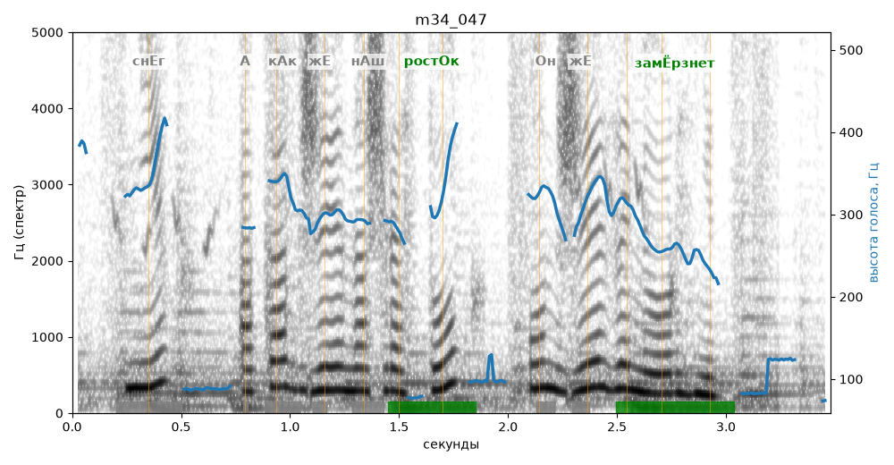

# m34_047

Голос: **Серия 34, Рон (327.0 с), голос iPhone** · длительность 3.5 с
Естественность (UTMOS): **1.38 из 5** (живой диктор ≈ 4–4.5)
Эталон: Снег? А как же наш росток? Он же замёрзнет!
Распознано: Снег, а как же наш расток, он же занёрзнет.
Расхождения в словах: «росток» → «расток»; «замерзнет» → «занерзнет»

## Ударения
(где нужно: ruaccent)

| слово | нужно | у голоса | |
|---|---|---|---|
| росток | ростОк | ростОк | ✓ |
| замёрзнет | замЁрзнет | замЁрзнет | ✓ |

## Интонация
- ✗ «а как же наш росток?» — нет вопросительного подъёма (самое высокое место — «как», в начале) — звучит как утверждение
- ✗ «он же замёрзнет!» — восклицание звучит ровно, без эмоции
- Диапазон голоса 26.0 полутонов (живо), средняя высота 288 Гц

## Паузы и темп
- паузы на своих местах
- Темп 5.3 слога/с (нормально)

_Синяя линия — высота голоса. Над словами заглавная буква — где ударение должно быть; красным — голос поставил не туда (уверенно), оранжевым — возможно._
