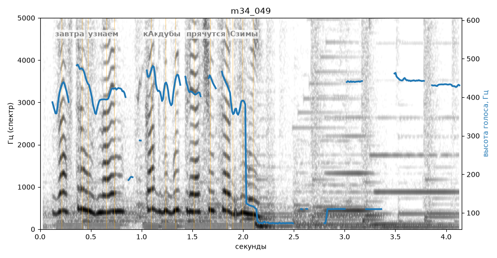

# m34_049

Голос: **Серия 34, Пик (336.4 с), голос iPhone** · длительность 4.2 с
Естественность (UTMOS): **1.24 из 5** (живой диктор ≈ 4–4.5)
Эталон: Завтра узнаем, как дубы прячутся от зимы.
Распознано: Завтра узнаем, как добыть прячутся одни мы.
Расхождения в словах: «дубы» → «добыть»; «от зимы» → «одни мы»

## Ударения
(где нужно: нет)

| слово | нужно | у голоса | |
|---|---|---|---|
| завтра | завтра | зАвтра | нет эталона |
| узнаем | узнаем | узнАем | нет эталона |
| дубы | дубы | дубЫ | нет эталона |
| прячутся | прячутся | прЯчутся | нет эталона |
| зимы | зимы | зИмы | нет эталона |

## Интонация
- ✓ «завтра узнаем как дубы прячутся от зимы.» — конец фразы понижается — звучит законченно
- Диапазон голоса 31.8 полутонов (живо), средняя высота 413 Гц

## Паузы и темп
- паузы на своих местах
- Темп 8.2 слога/с (быстро)

_Синяя линия — высота голоса. Над словами заглавная буква — где ударение должно быть; красным — голос поставил не туда (уверенно), оранжевым — возможно._
