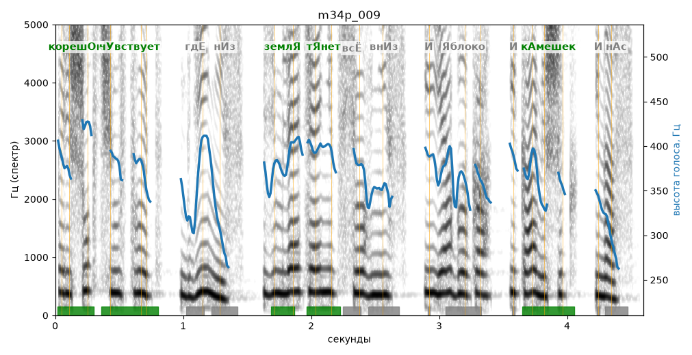

# m34p_009

Голос: **Пик (голос iPhone Milena), серия 34** · длительность 4.6 с
Эталон: Корешок чувствует, где низ. Земля тянет всё вниз — и яблоко, и камешек, и нас.
Распознано: Пришок чувствует, где несть, земля тебя не все вниз, и яблоко, и камешек, и нас.
Расхождения в словах: «корешок» → «пришок»; «низ» → «несть»; «тянет» → «тебя не»

## Ударения
(где нужно: ruaccent)

| слово | нужно | у голоса | |
|---|---|---|---|
| корешок | корешОк | корешОк | ✓ |
| чувствует | чУвствует | чУвствует | ✓ |
| земля | землЯ | землЯ | ✓ |
| тянет | тЯнет | тЯнет | ✓ |
| яблоко | Яблоко | — | ? |
| камешек | кАмешек | кАмешек | ✓ |

## Интонация
- ✓ «корешок чувствует где низ.» — конец фразы понижается — звучит законченно
- ✓ «земля тянет всё вниз и яблоко и камешек и нас.» — конец фразы понижается — звучит законченно
- Диапазон голоса 5.2 полутонов (нормально), средняя высота 371 Гц

## Паузы и темп
- паузы на своих местах
- Темп 6.9 слога/с (быстро)

_Синяя линия — высота голоса. Над словами заглавная буква — где ударение должно быть; красным — голос поставил не туда (уверенно), оранжевым — возможно._
