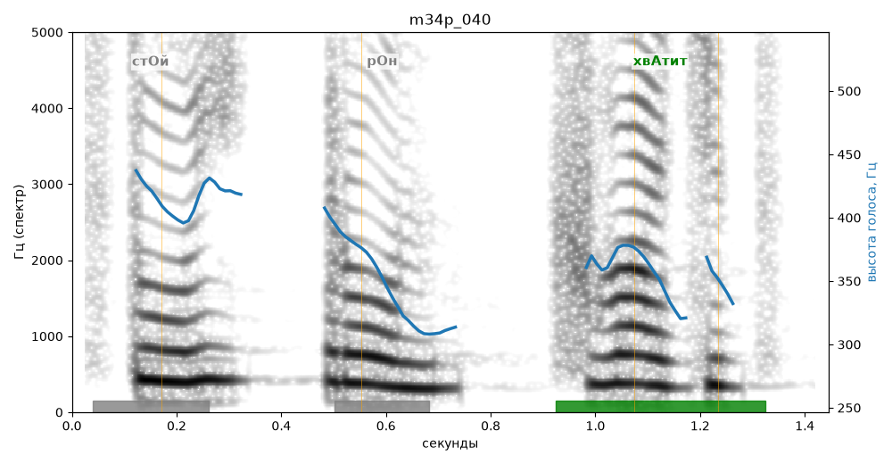

# m34p_040

Голос: **Пик (голос iPhone Milena), серия 34** · длительность 1.4 с
Эталон: Стой, Рон! Хватит!
Распознано: Стой, рон, кладит!
Расхождения в словах: «хватит» → «кладит»

## Ударения
(где нужно: ruaccent)

| слово | нужно | у голоса | |
|---|---|---|---|
| хватит | хвАтит | хвАтит | ✓ |

## Интонация
- Диапазон голоса 5.6 полутонов (нормально), средняя высота 369 Гц

## Паузы и темп
- паузы на своих местах
- Темп 5.0 слога/с (нормально)

_Синяя линия — высота голоса. Над словами заглавная буква — где ударение должно быть; красным — голос поставил не туда (уверенно), оранжевым — возможно._
