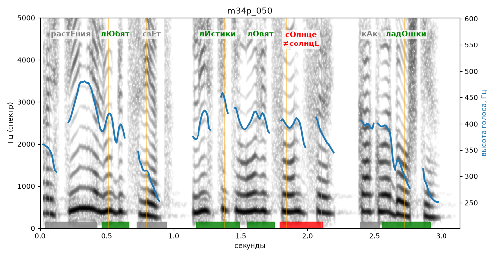

# m34p_050

Голос: **Пик (голос iPhone Milena), серия 34** · длительность 3.1 с
Эталон: Растения любят свет. Листики ловят солнце, как ладошки.
Распознано: Простинья любит свет, листите урад солнце, как у отошки.
Расхождения в словах: «растения любят» → «простинья любит»; «листики ловят» → «листите урад»; «ладошки» → «у отошки»

## Ударения
(где нужно: ruaccent)

| слово | нужно | у голоса | |
|---|---|---|---|
| растения | растЕния | — | ? |
| любят | лЮбят | лЮбят | ✓ |
| листики | лИстики | лИстики | ✓ |
| ловят | лОвят | лОвят | ✓ |
| солнце | сОлнце | солнцЕ | ✗ ОШИБКА |
| ладошки | ладОшки | ладОшки | ✓ |

## Интонация
- ✓ «растения любят свет.» — конец фразы понижается — звучит законченно
- ✓ «листики ловят солнце как ладошки.» — конец фразы понижается — звучит законченно
- Диапазон голоса 9.4 полутонов (живо), средняя высота 393 Гц

## Паузы и темп
- паузы на своих местах
- Темп 7.2 слога/с (быстро)

_Синяя линия — высота голоса. Над словами заглавная буква — где ударение должно быть; красным — голос поставил не туда (уверенно), оранжевым — возможно._
