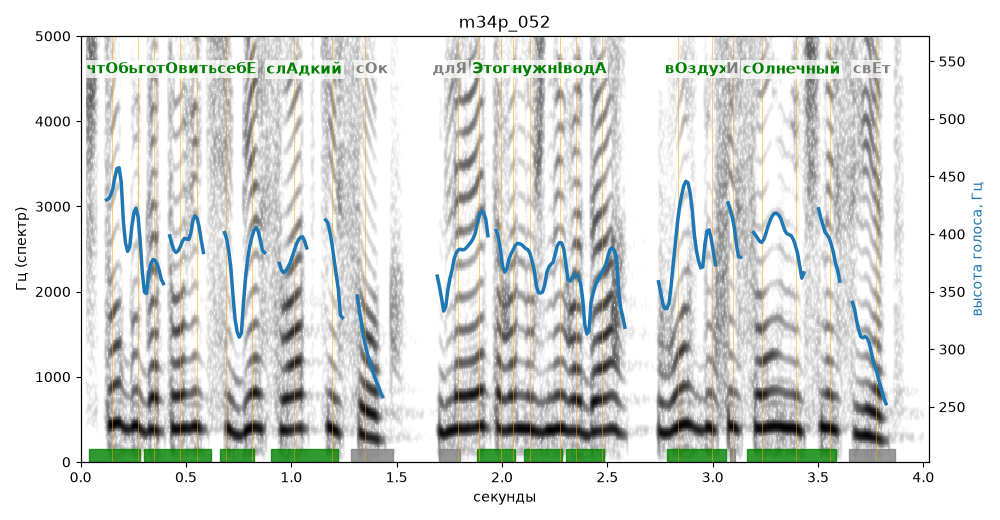

# m34p_052

Голос: **Пик (голос iPhone Milena), серия 34** · длительность 4.0 с
Эталон: Чтобы готовить себе сладкий сок. Для этого нужны вода, воздух и солнечный свет.
Распознано: Чтобы готовить себе сладкий сок, для этого нужны вода, воздухе солнечный свет.
Расхождения в словах: «воздух и» → «воздухе»

## Ударения
(где нужно: ruaccent)

| слово | нужно | у голоса | |
|---|---|---|---|
| чтобы | чтОбы | чтОбы | ✓ |
| готовить | готОвить | готОвить | ✓ |
| себе | себЕ | себЕ | ✓ |
| сладкий | слАдкий | слАдкий | ✓ |
| этого | Этого | Этого | ✓ |
| нужны | нужнЫ | нужнЫ | ✓ |
| вода | водА | водА | ✓ |
| воздух | вОздух | вОздух | ✓ |
| солнечный | сОлнечный | сОлнечный | ✓ |

## Интонация
- ✓ «чтобы готовить себе сладкий сок.» — конец фразы понижается — звучит законченно
- ✓ «для этого нужны вода воздух и солнечный свет.» — конец фразы понижается — звучит законченно
- Диапазон голоса 6.4 полутонов (нормально), средняя высота 384 Гц

## Паузы и темп
- паузы на своих местах
- Темп 7.6 слога/с (быстро)

_Синяя линия — высота голоса. Над словами заглавная буква — где ударение должно быть; красным — голос поставил не туда (уверенно), оранжевым — возможно._
