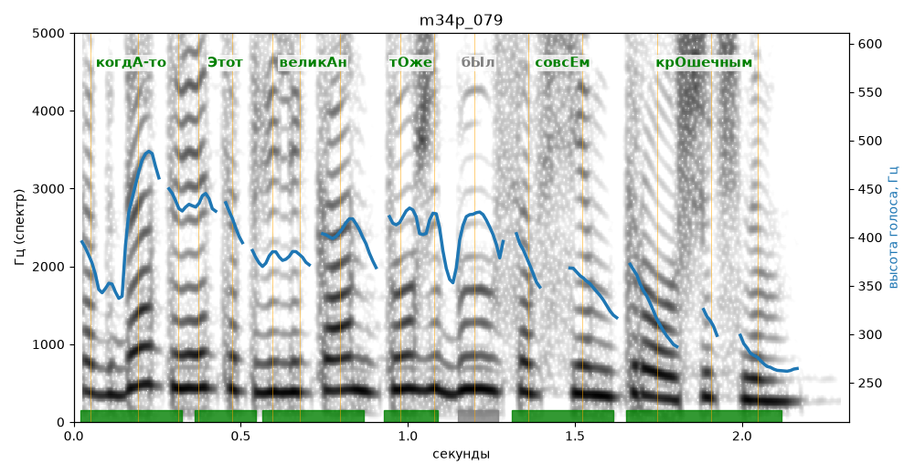

# m34p_079

Голос: **Пик (голос iPhone Milena), серия 34** · длительность 2.3 с
Эталон: Когда-то этот великан тоже был совсем крошечным.
Распознано: Когда-то этот великан тоже был совсем крошечным.
Слова: все совпали

## Ударения
(где нужно: ruaccent)

| слово | нужно | у голоса | |
|---|---|---|---|
| когда-то | когдА-то | когдА-то | ✓ |
| этот | Этот | Этот | ✓ |
| великан | великАн | великАн | ✓ |
| тоже | тОже | тОже | ✓ |
| совсем | совсЕм | совсЕм | ✓ |
| крошечным | крОшечным | крОшечным | ✓ |

## Интонация
- ✓ «когда-то этот великан тоже был совсем крошечным.» — конец фразы понижается — звучит законченно
- Диапазон голоса 8.9 полутонов (живо), средняя высота 382 Гц

## Паузы и темп
- паузы на своих местах
- Темп 7.6 слога/с (быстро)

_Синяя линия — высота голоса. Над словами заглавная буква — где ударение должно быть; красным — голос поставил не туда (уверенно), оранжевым — возможно._
