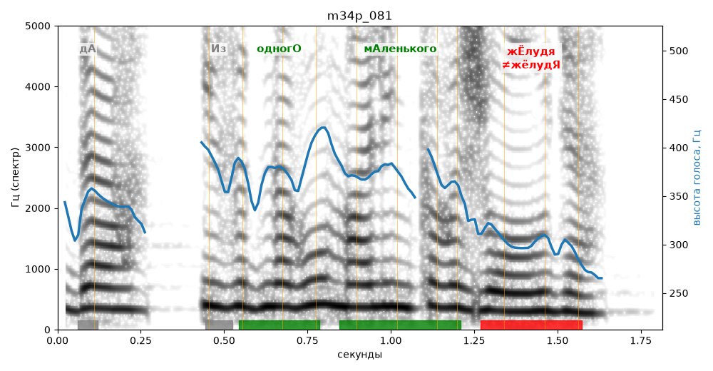

# m34p_081

Голос: **Пик (голос iPhone Milena), серия 34** · длительность 1.8 с
Эталон: Да. Из одного маленького жёлудя.
Распознано: Да, и задного маленького желда.
Расхождения в словах: «из одного» → «и задного»; «желудя» → «желда»

## Ударения
(где нужно: ruaccent)

| слово | нужно | у голоса | |
|---|---|---|---|
| одного | одногО | одногО | ✓ |
| маленького | мАленького | мАленького | ✓ |
| жёлудя | жЁлудя | жёлудЯ | ✗ ОШИБКА |

## Интонация
- ✓ «из одного маленького жёлудя.» — конец фразы понижается — звучит законченно
- Диапазон голоса 6.0 полутонов (нормально), средняя высота 354 Гц

## Паузы и темп
- паузы на своих местах
- Темп 10.1 слога/с (быстро)

_Синяя линия — высота голоса. Над словами заглавная буква — где ударение должно быть; красным — голос поставил не туда (уверенно), оранжевым — возможно._
